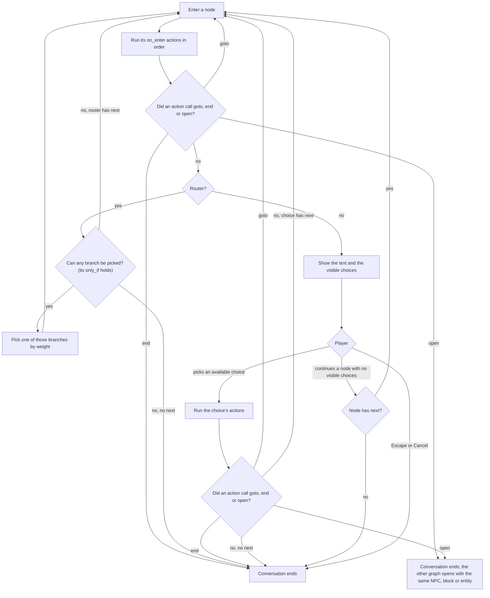

# Writing NPCs and conversations

For content writers. A content bundle is one JSON file that defines NPC profiles, dialogue graphs and dialogue flags.

Related pages: [README](../README.md), [server guide](server-guide.md) (installing, storage, configuration),
[models and animations](models-and-animations.md) (how NPCs look and move), [developer guide](developer-guide.md)
(building and extending Haruhi).

- [Workflow](#workflow)
- [The bundle file](#the-bundle-file)
- [NPC profiles](#npc-profiles)
- [Dialogue graphs and nodes](#dialogue-graphs-and-nodes)
- [How a conversation runs](#how-a-conversation-runs)
- [Bindings: blocks and entities](#bindings-blocks-and-entities)
- [Flags and visits](#flags-and-visits)
- [Built-in conditions](#built-in-conditions)
- [Built-in actions](#built-in-actions)
- [Validation](#validation)
- [Worked example](#worked-example)
- [The dialogue screen](#the-dialogue-screen)

## Workflow

Every `/haruhi` command on this page needs permission level 2 (game masters).

1. Save the bundle under the server's `config/haruhi/bundles/`, for example `config/haruhi/bundles/shop.json`.
   Subfolders are allowed. A name that leaves that folder, including through a symbolic link, is refused.
2. `/haruhi content validate shop.json` checks the whole file and lists every problem, one per line. A valid file
   answers `Valid: 2 NPCs, 2 graphs, digest <sha-256>`.
3. `/haruhi content import shop.json` validates again and stores the file as a new revision. It does not make it
   live: the reply names the revision id and the command to activate it. Importing content that matches a stored
   revision, ignoring whitespace and key order, returns that revision.
4. `/haruhi content activate <id>` makes the revision live. New conversations use it; a conversation already open
   finishes on the revision it started with, except that a `haruhi:open` it reaches opens the graph from the live
   revision, or ends the conversation when the live revision lacks that graph. Loaded NPCs pick up their new name,
   look and scale at once.
5. `/haruhi npc spawn <profile> [pos]` places an NPC with a profile from the live content. At another position it
   turns to face you; without `pos` it spawns where you stand, facing the opposite way to you. Right-click it to talk.

Other commands that help while writing:

| Command | What it does |
|---|---|
| `/haruhi content status` | The live revision id, its digest, and how many NPCs and graphs it has. |
| `/haruhi content list` | The 20 newest stored revisions, with author, digest and which one is active. |
| `/haruhi content rollback` | Re-activates the most recently activated revision other than the live one. |
| `/haruhi npc set <entity> <profile>` | Gives an existing NPC another profile. |
| `/haruhi npc remove <entity>` | Removes an NPC. |
| `/haruhi npc list` | Lists every loaded NPC with its profile, dimension and position. |
| `/haruhi dialogue open <graph> [targets]` | Opens a graph for players without an NPC, which is a quick way to test one graph. |
| `/haruhi dialogue close [targets]` | Ends the players' conversations. |
| `/haruhi bind block <pos> <graph> [<speaker>]`, `/haruhi bind entity <targets> <graph> [<speaker>]` | Binds a graph to a block or an entity, so using it opens the graph. See [Bindings](#bindings-blocks-and-entities). |
| `/haruhi unbind block <pos>`, `/haruhi unbind entity <targets>` | Removes a block's or the selected entities' bindings. |
| `/haruhi bindings [all]` | Lists bindings nearby, or all of them, and marks those whose graph or speaker profile the live content lacks. |
| `/haruhi flags get <player> <namespace> <flag>` | Shows a player's flag value. |
| `/haruhi flags set <player> <namespace> <flag> [value]` | Sets a flag; `value` defaults to 1. |
| `/haruhi flags clear <player> <namespace> <flag>` | Clears a flag. |

The flag commands only accept flags the live content declares, and only once that player's dialogue data has loaded.
A namespace such as `shop:mira` contains a colon, so quote it: `/haruhi flags get @s "shop:mira" met`.

At server start Haruhi activates the stored active revision. When storage has none, it imports and activates
`config/haruhi/bundle.json` if that file exists, and otherwise the small example bundle built into the mod. With the
default in-memory storage nothing survives a restart, so a revision you activated by command is gone after one; see
the [server guide](server-guide.md) for PostgreSQL storage.

### From the Portal

On a server with [remote content](server-guide.md#remote-content-from-the-portal) on, the Lampas Portal's content
editor does steps 1 to 4 without files or commands. It talks to the server over the management connection, and the
server fetches each bundle from the Portal, so the bundle's size is not limited by a management message.

- **Send for review** runs the server's check, `haruhi:content/validate`: the same validation as `/haruhi content
  validate`, with every registered condition, action, provider and extension. Nothing is stored. The Portal shows each
  problem at its place, from the `<where>` part of Haruhi's `<where>: <problem>` (the forms are in
  [Validation](#validation)). A refused bundle lists its first 500 problems and the total.
- **Put live**, for admins, checks again, then imports the bundle with `haruhi:content/import`, which stores a revision
  whose author is the writer followed by ` (request <id>)`, and activates it with `haruhi:content/activate`, with the admin as the activator. Content
  that is already stored returns the existing revision, so sending the same bundle twice stores one revision.
- **Versions** are Haruhi's revision ids. Going back to a version activates that revision by id; the Portal never
  sends `/haruhi content rollback`, which flips between the last two activated revisions.
- What reaches players is the same as for an activation by command: new conversations use the new revision and open
  ones finish on theirs ([what an activation reaches](server-guide.md#what-an-activation-reaches)).

Placing the content in the world stays in-game: the Portal writes the `/haruhi npc spawn` and `/haruhi bind` commands
for someone to run. It lists the bindings and NPCs the server has through `haruhi:content/bindings`.

## The bundle file

A bundle is one JSON object:

```json
{
  "schema": 1,
  "flags": { },
  "npcs": { },
  "dialogues": { },
  "extensions": { }
}
```

| Key | Required | Value |
|---|---|---|
| `schema` | yes | `1`. Any other number is refused. |
| `flags` | no | Flag namespaces, each an id mapped to an array of flag names. See [Flags and visits](#flags-and-visits). |
| `npcs` | no | NPC profiles, each an id mapped to a profile object. |
| `dialogues` | no | Dialogue graphs, each an id mapped to a graph object. |
| `extensions` | no | Sections owned by other mods, each an extension id mapped to that mod's section. Validation refuses an id that no installed mod registered. Each mod documents its own section. |

Rules that apply everywhere in the file:

- The file is strict JSON: comments, trailing commas and unquoted keys are syntax errors.
- Ids are `namespace:path`. The namespace uses `a-z 0-9 _ . -`, the path the same plus `/`. An id without a colon
  gets the `minecraft` namespace, so write the namespace every time. NPC, graph and flag namespace keys are ids.
- Node ids are plain strings and only need to be unique inside their graph.
- Text fields take Minecraft's text component JSON: a plain string such as `"Hello."`, or a component object such as
  `{"text": "Hello.", "color": "gold"}`.
- Node text, choice text, unavailable messages and speaker names are resolved for the player each time a node is
  shown, as sign text is: `{"score": {"name": "@s", "objective": "coins"}}` shows the player's own score, a
  `selector` component lists the entities it matches, and an `nbt` component shows the data it names. Each part of a
  text resolves on its own: a part that cannot be resolved is sent as written, and a `score` whose name does not match
  exactly one entity shows nothing. Selector and nbt components run each time the node is shown, so keep their
  selectors narrow. The entries of a choice provider are shown as the providing mod gives them, unresolved.
- Keys are snake_case, and an unknown key is an error at every level: bundle, NPC, graph, node, choice, router branch
  and the arguments of every built-in condition and action. A misspelt `only_if` fails validation instead of silently
  removing a gate. Types that other mods register decide for themselves which arguments they refuse.
- Two keys in one section that parse to the same id, such as `guard` and `minecraft:guard`, are an error.
- Exact duplicate keys are not detected. The JSON parser keeps the last of two identical keys in one object (two
  `"text"` keys in a node, or the same NPC key twice), and validation sees only that one.

### Checking a bundle in an editor

[`bundle.schema.json`](bundle.schema.json) is a JSON Schema (draft 2020-12) of this format and of the built-in
conditions and actions. An editor that reads JSON Schema uses it to complete keys and to mark unknown keys, missing
fields, wrong types and bad built-in arguments as you type. It does not replace `/haruhi content validate`, which also
checks references between nodes, graphs and NPCs, reachability, flag declarations, types registered by other mods and
the command allowlist.

A bundle cannot name its schema with a `$schema` key, because validation refuses unknown keys. Map the schema to the
bundle files in the editor's settings instead. In VS Code, copy `bundle.schema.json` to the root of the folder you
open, and add this to that folder's `.vscode/settings.json`:

```json
{
  "json.schemas": [
    {
      "fileMatch": ["**/config/haruhi/bundles/**/*.json", "**/config/haruhi/bundle.json"],
      "url": "./bundle.schema.json"
    }
  ]
}
```

## NPC profiles

A profile says what an NPC is called, how it looks and which conversation it opens. Every NPC entity is the same
`haruhi:npc` type; its profile id selects the profile.

```json
"npcs": {
  "shop:mira": {
    "name": "Mira",
    "texture": "minecraft:textures/entity/player/wide/steve.png",
    "dialogue": "shop:mira"
  }
}
```

| Field | Required | Default | Meaning |
|---|---|---|---|
| `name` | yes | | Text. Shown on the NPC's name tag and as the speaker name in the dialogue box. |
| `texture` | yes | | Texture id with its full path, such as `minecraft:textures/entity/player/wide/steve.png`. Without `model` it is a 64x64 player-layout skin. |
| `model` | no | the built-in humanoid | GeckoLib model id. |
| `animations` | no | the model's own animations file, else the humanoid set | GeckoLib animations id. |
| `portrait` | no | none | Texture id of a 2D portrait for the dialogue box. Make it square; it is stretched to a square. |
| `dialogue` | no | none | Graph id opened when a player right-clicks the NPC. It must be a graph in the same bundle. Without it the NPC does not talk. |
| `scale` | no | `1.0` | Size of the model and the hitbox. Must be above 0 and at most 4. A value below 0.0625 acts as 0.0625, the smallest value Minecraft's scale attribute allows. |

The server does not check `model`, `texture`, `animations` or `portrait`: they are client assets. A client that lacks
one falls back to the built-in humanoid, the Steve skin or the 3D headshot. [Models and
animations](models-and-animations.md) covers asset paths, fallbacks and making models.

What the NPC entity does:

- It stays where it is spawned. It has no AI, never falls, is not pushed and does not despawn. Only a teleport moves
  it.
- It takes no damage except from `/kill` and the void.
- Its hitbox is 0.6 x 1.8 blocks times `scale`, whatever the size of its model. Players must click inside that box to
  talk to it.
- Right-clicking it with the main hand turns it to face the player and opens its `dialogue`.
- An NPC whose profile is missing from the live content draws with the default look, has the profile id as its
  name, and does nothing when clicked.

## Dialogue graphs and nodes

A graph is one conversation: named nodes and the node it starts at.

```json
"dialogues": {
  "shop:old_tom": {
    "start": "line",
    "nodes": {
      "line": { "text": "Lovely weather for it." }
    }
  }
}
```

| Graph field | Required | Meaning |
|---|---|---|
| `start` | yes | The id of the first node. |
| `nodes` | yes | Node ids mapped to node objects. Every node must be reachable from `start` (see [Validation](#validation)). |

### Nodes

There are three kinds of node:

- A **line**: `text` and no `choices`. The player continues to `next`; with no `next`, continuing ends the conversation.
- A **menu**: `text` and `choices`. The player picks one of the visible choices.
- A **router**: `random` and no `text` or `choices`. It shows nothing and moves straight on to one branch, picked by
  weight among the branches whose conditions hold, or to its `next` when none hold (see
  [Branching without the player](#branching-without-the-player)).

| Node field | Applies to | Default | Meaning |
|---|---|---|---|
| `text` | line, menu | required | What the speaker says. Text component. |
| `choices` | menu | none | Array of choices, shown in order. |
| `next` | all | none | Node to move to on continue. On a menu it is used only when every choice is hidden. On a router it is used only when no branch can be picked. |
| `random` | router | none | Array of branches, `{"node": "<id>", "weight": <whole number>, "only_if": [<conditions>]}`; `only_if` is optional. Each weight must be above 0, and the weights may add up to at most 2147483647. A branch's chance is its weight over the total weight of the branches that can be picked. |
| `on_enter` | all | `[]` | Actions run, in order, every time the node is entered. |
| `speaker` | line, menu | the NPC being talked to, or the binding's speaker | NPC profile id whose name and portrait the box shows. Must be an NPC in the bundle. |
| `portrait` | line, menu | the speaker's `portrait` | Texture id of a 2D portrait for this node only. |
| `animation` | line, menu | none | Animation name the speaking NPC plays when the node shows. |

A router uses only `random`, `next` and `on_enter`. A branch with `only_if` can be picked only when all of its
conditions hold. When no branch can be picked, the router moves to its `next`, or ends the conversation when it has
none. A branch without `only_if` can always be picked, so a router with such a branch never uses its `next`, and the
reachability check counts a router's `next` only when every branch has `only_if`.

`speaker`, `portrait` and `animation` work together:

- With no `speaker`, the NPC the player is talking to speaks. A conversation opened by command has no NPC, so its
  nodes show no name unless they set `speaker`.
- A graph bound to a block or entity (see [Bindings](#bindings-blocks-and-entities)) is spoken, on nodes with no
  `speaker`, by the binding's speaker profile, or without one by the block or entity itself under its own name, such
  as "Lectern" or "Librarian". A bound living entity (a villager, an armor stand, a mob) is drawn as the 3D head;
  other entities, such as an `interaction` entity or an item frame, and blocks have none.
- The 3D head render in the dialogue box applies when the speaker is the entity being talked to, and the node's
  `animation` only when that entity is a Haruhi NPC. A node whose `speaker` is a different profile shows that profile's
  name and its `portrait` if it has one, and no 3D head.
- A portrait that the player's client does not have is skipped, and the 3D head shows instead when it can.

### Branching without the player

A router branch with `only_if` is how a character says one thing to one player and another thing to someone else,
without the player picking anything. The router tests each branch's conditions, picks by weight among the branches
whose conditions all hold, and moves to its `next` when none do. A greeting that differs for returning players:

```json
"greet": {
  "random": [
    {
      "node": "welcome_back",
      "weight": 1,
      "only_if": [ { "type": "haruhi:flag", "namespace": "shop:mira", "flag": "met", "op": "set" } ]
    }
  ],
  "next": "first_meeting"
},
"first_meeting": {
  "text": "I don't think we've met. I'm Mira.",
  "on_enter": [ { "type": "haruhi:flag/set", "namespace": "shop:mira", "flag": "met" } ],
  "next": "menu"
},
"welcome_back": { "text": "Back again? Good to see you.", "next": "menu" }
```

A player who has met Mira goes to `welcome_back`; anyone else goes to `first_meeting`, which sets `met` for next time.

- The conditions are tested after the router's own `on_enter`, and flags change at once, so a flag set earlier in the
  same step counts: by the choice that led to the router, by a node entered on the way, or by the router's `on_enter`.
- Several conditions on one branch must all hold. Use `haruhi:any_of` for "either", and `haruhi:not` for "unless".
- When several branches can be picked, the weights decide between them, so two branches gated on the same flag give
  returning players a random greeting. Branches are not checked in order, and a branch without `only_if` is always
  among them, so it is not an "otherwise": the router's `next` is. For "first this, else that, else the other", chain
  routers: give the first router one branch and make its `next` a second router.
- Each router counts as a node entered, toward the limit of 64 in one step.

```json
"greet": {
  "random": [
    { "node": "night_greeting", "weight": 1, "only_if": [ { "type": "haruhi:time", "from": 13000, "to": 23000 } ] }
  ],
  "next": "greet_by_day"
},
"greet_by_day": {
  "random": [
    {
      "node": "welcome_back",
      "weight": 1,
      "only_if": [ { "type": "haruhi:flag", "namespace": "shop:mira", "flag": "met", "op": "set" } ]
    }
  ],
  "next": "first_meeting"
}
```

Here the night greeting comes first for everyone; by day the player gets `welcome_back` or `first_meeting` as above.

### Choices

| Choice field | Default | Meaning |
|---|---|---|
| `text` | | What the choice says. A choice needs `text` or `provider`. |
| `next` | none | Node to move to after the actions. With no `next`, and no action that moved or ended the conversation, picking the choice ends the conversation. |
| `only_if` | `[]` | Conditions. All of them must be true for the choice to be available. Use `haruhi:any_of` for "either". |
| `when_unavailable` | `"hidden"` | `"hidden"` leaves an unavailable choice out. `"grayed_out"` shows it dimmed and unpickable. |
| `unavailable_message` | none | Text shown when the player hovers a grayed-out choice. |
| `actions` | `[]` | Actions run, in order, when the player picks the choice. |
| `provider` | none | A choice provider, written like an action: `{"type": "<id>", ...arguments}`. |

A provider expands into any number of choices, generated each time the node is shown. Its choices bring their own
text, action and target node, and can be grayed out with a reason; the choice's own `text`, `next` and `actions` are
not used. Its `only_if` still decides whether the provider runs. Haruhi registers no providers itself; other mods can
(see the [developer guide](developer-guide.md)). A bundle that names an unregistered provider fails validation.

### Conditions and actions

A condition or action is an object whose `type` names a registered type; its other keys are that type's arguments:

```json
{ "type": "haruhi:flag", "namespace": "shop:mira", "flag": "met", "op": "set" }
```

The built-in types are listed in [Built-in conditions](#built-in-conditions) and [Built-in actions](#built-in-actions).
Each built-in type refuses arguments it does not take; a type from another mod follows its own rules.

## How a conversation runs

A conversation opens when a player right-clicks an NPC that has a `dialogue` or uses a block or entity bound to a
graph, when a command opens a graph, or when a `haruhi:open` action opens another graph. Opening a conversation ends
the player's current one. If the player's flags have not loaded yet (just after joining), the open waits for them.
Each open records a visit (see [Flags and visits](#flags-and-visits)), then enters the `start` node.



Entering a node runs its `on_enter` actions in order. `haruhi:goto`, `haruhi:end` and `haruhi:open` take effect after
all of that node's actions have run, and when several are called the last one wins. A node left this way is never
shown. Choices are worked out after `on_enter`, so a flag set in `on_enter` already counts for the node's own choices.
A router tests its branches' `only_if` after `on_enter` in the same way, then enters one branch, or its `next` (see
[Branching without the player](#branching-without-the-player)).

Showing a node sends the text, the speaker and the visible choices to the player. Hidden choices are left out;
grayed-out choices are listed but cannot be picked.

When the player picks a choice, the server works the node's choices out again. If the picked choice is no longer
available, or the choice at its place in the list is not the one that was shown, the node is shown again and nothing
runs. Otherwise the choice's actions run and the conversation moves to the node an action named, or to the choice's
`next`, or ends.

Continuing a node with no visible choices moves to its `next`, or ends the conversation. A menu whose choices are all
hidden at that moment behaves like a line. A menu whose visible choices are all grayed out cannot be continued, and
the player can only leave with Escape, so give every menu at least one choice that is always available.

A conversation also ends when:

- the player presses Escape, or Cancel in the vanilla dialog;
- the NPC or bound entity is more than 8 blocks away, dead or unloaded, or in another dimension;
- for a bound block, the player moves more than 8 blocks from it (or their block reach plus 3, when that is longer, up
  to 64) or changes dimension;
- the player dies, respawns or leaves;
- a condition, action or provider fails while running (the server logs the error);
- more than 64 nodes are entered in one step, which catches loops of routers and jumps;
- `haruhi:open` is chained more than 8 times in one step;
- a game master runs `/haruhi dialogue close`.

## Bindings: blocks and entities

A graph does not have to belong to an NPC. Staff can bind any graph of the active content to a placed block, such as a
lectern, a sign or a chest, or to an existing entity that is not a Haruhi NPC, such as a vanilla villager, an armor
stand or an `interaction` entity, with `/haruhi bind` (see the
[server guide](server-guide.md#haruhi-bind-unbind-and-bindings)). Using the block or entity then opens the graph in
place of its vanilla interaction.

Bindings live in the world, not in the bundle, so the bundle format has nothing for them. What the writer controls:

- The graph. Write it as any other graph; it needs no NPC profile. A bound graph that a later revision drops opens
  nothing, so keep its id when you rework it.
- The optional speaker profile given when binding. Nodes with no `speaker` show its name and portrait, and visits count
  under it, so a villager bound with the profile `shop:mira` is Mira for `haruhi:visits`. Without one, those nodes
  show the block's or entity's own name, and visits count under `haruhi:none`.
- `haruhi:open`, `haruhi:goto` and the rest work as in any conversation. A graph chained with `haruhi:open` keeps the
  block or entity and the speaker. `haruhi:animation` and a node's `animation` play only on Haruhi NPCs, so they do
  nothing in a bound conversation.

## Flags and visits

Flags are whole numbers stored per player character. They record what the player has done, and conditions read them
back.

Declare every flag before using it. The key is a flag namespace (an id, usually named after the graph that owns it),
and the value lists the flag names in it. A flag name is any non-empty string without a NUL character.

```json
"flags": {
  "shop:mira": ["met", "times_talked", "got_book"]
}
```

- A flag that was never set, or was cleared, reads as 0. A flag is "set" when its value is not 0.
- A condition or action names a flag by `namespace` and `flag`, and both must be declared in the bundle being
  validated. The namespace is matched exactly as written in `flags`, so write the same full id in both places.
- Flags are kept per character, which for now is the player's UUID. They are stored by namespace and name, so renaming
  either starts every player from 0. Values under the old name stay in storage.
- A change applies at once for the conversation and is written to storage in batches every 5 seconds, and when the
  player leaves or the server stops. A crash can lose the last few seconds of flag changes, so never rely on a plain
  flag to stop a reward from repeating; `haruhi:give` writes its own flag before it hands anything over.

Visits count how many times a character has opened a graph with an NPC profile. The count goes up when the graph
opens, so the current conversation is included: the first conversation reads 1. All NPCs with the same profile share
one count. A graph bound to a block or entity counts under the binding's speaker profile. A graph opened by command,
or bound without a speaker profile, counts under the profile id `haruhi:none`. Read visits with `haruhi:visits`.

## Built-in conditions

| Type | Arguments | True when | Example |
|---|---|---|---|
| `haruhi:all_of` | `conditions`: non-empty array of conditions | every one is true | `{"type": "haruhi:all_of", "conditions": [{"type": "haruhi:tag", "tag": "guild_member"}, {"type": "haruhi:weather", "weather": "clear"}]}` |
| `haruhi:any_of` | `conditions`: non-empty array of conditions | at least one is true | `{"type": "haruhi:any_of", "conditions": [{"type": "haruhi:weather", "weather": "rain"}, {"type": "haruhi:weather", "weather": "thunder"}]}` |
| `haruhi:not` | `condition`: one condition | that condition is false | `{"type": "haruhi:not", "condition": {"type": "haruhi:tag", "tag": "banned"}}` |
| `haruhi:flag` | `namespace`, `flag`: a declared flag. `op`: `set`, `unset`, `eq`, `ne`, `gt`, `gte`, `lt` or `lte`. `value`: whole number, required by the comparisons and refused by `set` and `unset` | `set`: the value is not 0. `unset`: it is 0. Otherwise the value (0 when unset) compared with `value` | `{"type": "haruhi:flag", "namespace": "shop:mira", "flag": "times_talked", "op": "gte", "value": 5}` |
| `haruhi:visits` | `op`: `eq`, `ne`, `gt`, `gte`, `lt` or `lte`. `value`: whole number | the visit count of this graph with this NPC profile (for a bound block or entity, the binding's speaker profile; see [Flags and visits](#flags-and-visits)), compared with `value` | `{"type": "haruhi:visits", "op": "eq", "value": 1}` |
| `haruhi:predicate` | `predicate`: id of a predicate from the server's data packs | the predicate passes, tested with the player as the entity and the player's position as the origin. A predicate the server does not have is false and logs a warning | `{"type": "haruhi:predicate", "predicate": "shop:in_market_square"}` |
| `haruhi:has_item` | `item`: item id, or `#` and an item tag id. `count`: at least 1, default 1 | the player's inventory, armor and off-hand slots included, holds at least `count` matching items in total. Nothing is taken | `{"type": "haruhi:has_item", "item": "minecraft:emerald", "count": 5}` |
| `haruhi:advancement` | `advancement`: id. `criterion`: optional criterion name | the player has completed the advancement, or that criterion of it. An unknown advancement is false | `{"type": "haruhi:advancement", "advancement": "minecraft:story/mine_diamond"}` |
| `haruhi:tag` | `tag`: a scoreboard tag, without whitespace | the player has that tag (`/tag`) | `{"type": "haruhi:tag", "tag": "guild_member"}` |
| `haruhi:permission` | `level`: 0 to 4 | the player has at least that operator permission level | `{"type": "haruhi:permission", "level": 2}` |
| `haruhi:time` | `from`, `to`: day-time ticks, 0 to 23999 | the time of day in the player's dimension is between `from` and `to`, both included. When `from` is above `to` the range wraps from 23999 to 0 | `{"type": "haruhi:time", "from": 13000, "to": 23000}` |
| `haruhi:weather` | `weather`: `clear`, `rain` or `thunder` | in the player's dimension: `clear` when it is not raining, `rain` when it rains without thunder, `thunder` during a thunderstorm | `{"type": "haruhi:weather", "weather": "clear"}` |

Conditions nested in `all_of`, `any_of` and `not` follow the same rules, including flag declarations. Validation does
not check that predicates, items, item tags or advancements exist; a wrong id makes the condition false at run time.

## Built-in actions

| Type | Arguments | Effect | Example |
|---|---|---|---|
| `haruhi:flag/set` | `namespace`, `flag`; `value`: whole number, default 1 | sets the flag to `value` | `{"type": "haruhi:flag/set", "namespace": "shop:mira", "flag": "met"}` |
| `haruhi:flag/add` | `namespace`, `flag`; `delta`: whole number, default 1 (negative subtracts) | adds `delta` to the current value (0 when unset) | `{"type": "haruhi:flag/add", "namespace": "shop:mira", "flag": "times_talked"}` |
| `haruhi:flag/clear` | `namespace`, `flag` | clears the flag, so it reads 0 and unset | `{"type": "haruhi:flag/clear", "namespace": "shop:mira", "flag": "met"}` |
| `haruhi:goto` | `node`: a node of the same graph | after the current actions, enters `node`: instead of the choice's `next`, or, in `on_enter`, instead of showing this node | `{"type": "haruhi:goto", "node": "menu"}` |
| `haruhi:end` | none | after the current actions, ends the conversation | `{"type": "haruhi:end"}` |
| `haruhi:open` | `graph`: a graph of the same bundle | after the current actions, ends this conversation and opens `graph` with the same NPC, or the same bound block or entity and its speaker | `{"type": "haruhi:open", "graph": "shop:mira_quest"}` |
| `haruhi:animation` | `animation`: an animation name | the NPC being talked to plays the animation, for every player whose client tracks it and has Haruhi and GeckoLib. Does nothing in a conversation without an NPC | `{"type": "haruhi:animation", "animation": "wave"}` |
| `haruhi:sound` | `sound`: sound event id; `volume`: not negative, default 1; `pitch`: above 0, default 1 | plays the sound at the player's position, in the master category. Players nearby hear it too. The id is not checked | `{"type": "haruhi:sound", "sound": "minecraft:entity.item.pickup"}` |
| `haruhi:message` | `text`: text component | sends the text to the player's chat as written: `score`, `selector` and `nbt` components in it are not resolved | `{"type": "haruhi:message", "text": {"text": "Mira hums to herself.", "italic": true}}` |
| `haruhi:give` | `loot_table`: loot table id; `once`: `{"namespace", "flag"}`, required | gives the loot table's items once per character. See below | `{"type": "haruhi:give", "loot_table": "minecraft:gameplay/hero_of_the_village/librarian_gift", "once": {"namespace": "shop:mira", "flag": "got_book"}}` |
| `haruhi:command` | `command`: a command, with or without the leading `/` | runs the command as the player. Only allowlisted commands validate. See below | `{"type": "haruhi:command", "command": "clear @s minecraft:emerald 5"}` |

### haruhi:give and its once rule

`haruhi:give` is built so a reward is never given twice, even across a crash:

1. If the `once` flag is already set, it does nothing.
2. If the server has no loot table with that id, it logs an error and does nothing. The flag stays unset.
3. Otherwise it sets the `once` flag to 1 and writes it to storage straight away, bypassing the 5-second batch.
4. Only after storage confirms the write does it roll the loot table for the player (the player is the entity and the
   player's position the origin) and put the items in the inventory. Items that do not fit are dropped, as vanilla does
   when an inventory is full.
5. If the write fails, the flag goes back to what it was, nothing is given, and the error is logged.

A player who is dead or offline when the write completes gets the items on the first tick they are online and alive
again. If the server stops before then, the reward is lost and the log says it must be granted by hand. A crash
between the write and the hand-over also loses it. Either way the flag is set, so the reward is never duplicated.

The flag is set in the conversation at once, so an `only_if` that tests the same flag with `"op": "unset"` hides the
choice as soon as the reward is taken.

### haruhi:command and its allowlist

`haruhi:command` runs a command as the player, so `@s` is the player and the command runs at the player's position.
It runs at the permission level set in `config/haruhi-dialogue.json`, whatever the player's own level is. The server
operator controls that file:

```json
{
  "command_permission_level": 2,
  "command_allowlist": []
}
```

| Key | Default | Meaning |
|---|---|---|
| `command_permission_level` | `2` | Permission level the commands run at, 0 to 4. |
| `command_allowlist` | `[]` | Command names, such as `"clear"`. A command validates only when its first word is on this list, compared exactly. The default allows none. |

- The file is created with these defaults when it is missing. It is read once, when the mod loads at startup, so a
  change needs a restart. A file that cannot be read, or holds a level outside 0 to 4, leaves command actions
  disabled, and the log says why.
- A command whose first word is not on the list is a validation error. Allowing a command allows it with any
  arguments.
- Removing a command from the allowlist also invalidates stored revisions that use it. If the live revision stops
  validating, the server starts with no content active.

Haruhi has no built-in action that takes items. With `clear` on the allowlist, a choice gated by `haruhi:has_item`
can run `clear @s minecraft:emerald 5`.

## Validation

`/haruhi content validate <file>`, `import`, `activate` and the server start all run the same full check. Run
`validate` after every edit: it reports every problem in the file in one pass, and changes nothing. A JSON syntax error
is the exception: the check stops at the first one. Activation checks the stored revision again, so a revision that no
longer validates on this server (for example after an allowlist change) is refused. At server start, a live revision
that fails validation leaves the server with no content, and the log lists every problem.

What is checked:

- The file is strict JSON, and `schema` is 1.
- Every key is known, every required field is present, and every value has the right type.
- NPC, graph and flag namespace keys are valid ids, and no two keys in a section parse to the same id.
- `scale` is above 0 and at most 4.
- Every reference resolves: an NPC's `dialogue` graph, a node's `speaker` NPC, the graph's `start`, every `next`,
  router branch and `haruhi:goto` node in the same graph, and every `haruhi:open` graph in the bundle.
- Router rules: no `text` or `choices`, at least one branch, every weight above 0, weights adding up to at most
  2147483647, and a branch's `only_if` is a list of conditions. Every other node has `text`. Every choice has `text`
  or `provider`, and `when_unavailable` is `hidden` or `grayed_out`.
- Every condition, action and provider type is registered, and its arguments parse by that type's rules, including
  nested conditions.
- Every flag a condition or action uses is declared.
- Every `haruhi:command` is on the allowlist.
- Every node is reachable from `start`, following `next` (a router's only when every one of its branches has
  `only_if`), choice `next`, router branches and `haruhi:goto` targets. A graph where a reachable node holds a
  provider choice is exempt, because a provider names its target node only at run time.

Not checked, because they are only known at run time or on the player's client: model, texture, animations and
portrait ids; animation names; sound ids; item and item tag ids; loot tables, predicates and advancements. Each falls
back or fails soft at run time, as the tables above say.

Each problem is one line, `<where>: <problem>`. `<where>` is `bundle`, `npc <id>`, `<graph>`, `<graph>#<node>`,
`<graph>#<node>, choice <n>` or `<graph>#<node>, random entry <n>`, and for a bundle extension `extension <id>` or a
location the extension's parser names, which starts with it (Alina writes `extension alina:guild, commission <id>`).
Problems with the arguments of a condition or action name the node and the type, but not the choice or random entry
number. A JSON syntax error is reported as `bundle: not valid JSON: <parser message>`, usually followed by a second
line with the parser's troubleshooting link; a file that ends early gives the first line only. Some
messages:

| Mistake | Message |
|---|---|
| `"schema": 2` | `bundle: schema 2 is not supported, this build reads schema 1` |
| A top-level `"npc"` key | `bundle: unknown key 'npc'` |
| A profile without `name` | `npc shop:mira: name is required` |
| `"scale": 5` | `npc shop:mira: scale must be above 0 and at most 4` |
| A misspelt `dialogue` | `npc shop:mira: dialogue 'shop:mria' is not a dialogue in this bundle` |
| NPC keys `guard` and `minecraft:guard` | `bundle: npcs keys 'guard' and 'minecraft:guard' both name minecraft:guard` |
| `onlyIf` in a choice | `shop:mira#menu, choice 1: unknown key 'onlyIf'` |
| A line without `text` | `shop:mira#intro: text is required` |
| A choice `next` that names no node | `shop:mira#menu, choice 2: next 'rumor' is not a node in this graph` |
| A router with `text` | `shop:mira#greet: a router node has no text` |
| A weight of 0 | `shop:mira#greet, random entry 2: weight must be above 0` |
| `onlyIf` in a router branch | `shop:mira#greet, random entry 1: unknown key 'onlyIf'` |
| A node nothing leads to | `shop:mira#old_line: node is not reachable from start 'greet'` |
| A misspelt condition type | `shop:mira#menu, choice 1: condition haruhi:flags is not registered` |
| An undeclared flag | `shop:mira#menu: haruhi:flag: flag 'mett' is not declared in namespace 'shop:mira'` |
| A misspelt argument | `shop:mira#menu: haruhi:flag/set: no argument named 'val'` |
| A wrong op | `shop:mira#menu: haruhi:flag: 'op' must be one of set, unset, eq, ne, gt, gte, lt, lte, not 'is_set'` |
| A command not on the allowlist | `shop:mira#menu: haruhi:command: command 'give' is not on the allowlist in haruhi-dialogue.json` |

## Worked example

This bundle has a shopkeeper, Mira, and a passer-by, Old Tom. Mira's conversation has:

- a greeting router (`greet`) that counts the visit in a flag, greets a newcomer, and gives a player Mira has met a
  warm greeting three times out of four;
- a choice gated on a flag: "Heard any rumours?" stays hidden until the player has introduced themselves;
- a grayed-out choice with a reason: "Can I see the back room?" can only be picked at night, and says why on hover;
- a reward given once: "Got anything to read?" gives a book through `haruhi:give` and disappears once taken;
- a choice with no `next` ("Just browsing."), which ends the conversation.

Old Tom has a one-line script. Both use the built-in humanoid with the Steve skin; replace `texture` (and add `model`)
with your own assets, as [Models and animations](models-and-animations.md) describes.

```json
{
  "schema": 1,
  "flags": {
    "shop:mira": ["met", "times_talked", "got_book"]
  },
  "npcs": {
    "shop:mira": {
      "name": "Mira",
      "texture": "minecraft:textures/entity/player/wide/steve.png",
      "dialogue": "shop:mira"
    },
    "shop:old_tom": {
      "name": "Old Tom",
      "texture": "minecraft:textures/entity/player/wide/steve.png",
      "dialogue": "shop:old_tom",
      "scale": 0.9
    }
  },
  "dialogues": {
    "shop:mira": {
      "start": "greet",
      "nodes": {
        "greet": {
          "on_enter": [
            { "type": "haruhi:flag/add", "namespace": "shop:mira", "flag": "times_talked" }
          ],
          "random": [
            {
              "node": "greet_again",
              "weight": 1,
              "only_if": [
                { "type": "haruhi:flag", "namespace": "shop:mira", "flag": "met", "op": "set" }
              ]
            }
          ],
          "next": "greet_new"
        },
        "greet_new": {
          "text": "Hello there. I don't think I know you.",
          "next": "menu"
        },
        "greet_again": {
          "random": [
            { "node": "greet_warm", "weight": 3 },
            { "node": "greet_busy", "weight": 1 }
          ]
        },
        "greet_warm": {
          "text": "Welcome in! Mind the crates.",
          "animation": "wave",
          "next": "menu"
        },
        "greet_busy": {
          "text": "Oh, a customer. One moment...",
          "next": "menu"
        },
        "menu": {
          "text": "What can I do for you?",
          "choices": [
            {
              "text": "I'm new in town.",
              "next": "intro",
              "only_if": [
                { "type": "haruhi:flag", "namespace": "shop:mira", "flag": "met", "op": "unset" }
              ],
              "actions": [
                { "type": "haruhi:flag/set", "namespace": "shop:mira", "flag": "met" }
              ]
            },
            {
              "text": "Heard any rumours?",
              "next": "rumour",
              "only_if": [
                { "type": "haruhi:flag", "namespace": "shop:mira", "flag": "met", "op": "set" }
              ]
            },
            {
              "text": "Got anything to read?",
              "next": "book",
              "only_if": [
                { "type": "haruhi:flag", "namespace": "shop:mira", "flag": "got_book", "op": "unset" }
              ],
              "actions": [
                {
                  "type": "haruhi:give",
                  "loot_table": "minecraft:gameplay/hero_of_the_village/librarian_gift",
                  "once": { "namespace": "shop:mira", "flag": "got_book" }
                }
              ]
            },
            {
              "text": "Can I see the back room?",
              "next": "back_room",
              "only_if": [
                { "type": "haruhi:time", "from": 13000, "to": 23000 }
              ],
              "when_unavailable": "grayed_out",
              "unavailable_message": "Mira only opens the back room after dark."
            },
            { "text": "Just browsing." }
          ]
        },
        "intro": {
          "text": "Then welcome. I'm Mira, and I sell a bit of everything.",
          "next": "menu"
        },
        "rumour": {
          "text": "They say the old mill turns on its own at night.",
          "next": "menu"
        },
        "book": {
          "text": "Here, take this one. Bring it back when you're done. Or don't.",
          "on_enter": [
            { "type": "haruhi:sound", "sound": "minecraft:entity.item.pickup" }
          ],
          "next": "menu"
        },
        "back_room": {
          "text": "Mind the dust. Most of this is not for sale.",
          "next": "menu"
        }
      }
    },
    "shop:old_tom": {
      "start": "line",
      "nodes": {
        "line": { "text": "Lovely weather for it." }
      }
    }
  }
}
```

How it plays:

- `greet` adds 1 to `times_talked` on every visit. A player who has not met Mira yet goes to its `next`,
  `greet_new`. Once `met` is set, `greet` goes to `greet_again`, which routes to `greet_warm` (weight 3) or
  `greet_busy` (weight 1). `greet_warm` plays the humanoid's `wave` clip on Mira, which the talking player sees when
  their client has GeckoLib.
- On a first visit `menu` shows "I'm new in town.", "Got anything to read?", the grayed-out back room choice by day,
  and "Just browsing.". Picking "I'm new in town." sets `met`; back at `menu` that choice is hidden and "Heard any
  rumours?" shows instead.
- "Got anything to read?" gives the book, sets `got_book`, and leads to `book`, which plays a pickup sound. Back at
  `menu` the choice is gone, on this and every later visit.
- Every branch returns to `menu`, so the player leaves with "Just browsing." or Escape.
- Old Tom's single line has no `next`, so continuing it ends the conversation.

To try it:

1. Save it as `config/haruhi/bundles/shop.json` on the server.
2. `/haruhi content validate shop.json`, then `/haruhi content import shop.json`, then `/haruhi content activate <id>`
   with the id from the import reply.
3. `/haruhi npc spawn shop:mira ^ ^ ^3` and `/haruhi npc spawn shop:old_tom ^2 ^ ^3`. The `^` coordinates put them in
   front of you, facing you.
4. Right-click Mira. To replay the first visit, `/haruhi flags clear @s "shop:mira" met` and
   `/haruhi flags clear @s "shop:mira" got_book`.

## The dialogue screen

Players whose client has Haruhi see a visual-novel screen. The server has a vanilla dialog fallback for other clients
(see the end of this section), but in practice every player needs Haruhi to join.

Layout:

- A text box runs along the bottom of the screen. The world stays visible around it, and the game is not paused.
- At the box's top left, a square headshot shows the speaker: the node's or profile's portrait when the client has the
  texture, else a 3D render of the head and shoulders of the NPC or bound entity being talked to, when it is the
  speaker and it is loaded. With neither, there is no headshot and the text starts at the box's left edge. On a very
  small window the headshot is left out.
- Right of the headshot: the speaker's name, a divider, and the text, which types out character by character. The box
  grows with the text up to two fifths of the screen's height (or a full headshot's height, where that is more),
  and never into the room left above it for the choices.
- Text longer than the box holds is split into pages, so a long speech can stay in one node; you never need to know
  the box's size. Pages break between whole lines, and at a blank line (a paragraph break) when one falls in the lower
  half of the page. Each page types out on its own, and a page indicator such as `1/3` shows at the bottom right. How
  many pages a text takes depends on the player's window and GUI scale, so do not write text that refers to a page.
- Choices stack above the box on the right, once the last page is shown. The first nine are numbered `1.` to `9.`.
  Each label is one line, and a label too long for its row is cut short, so keep choice text short. Grayed-out choices
  are dimmed. When there are more choices than fit, the list scrolls and arrows mark the hidden ones.
- When a page has finished and another follows, "Space or click for more" shows at the bottom right. When the last
  page has finished and the node has no choices, "Space or click to continue" shows there.

Controls:

| Input | Effect |
|---|---|
| Left click, Space, Enter or keypad Enter | While a page types: shows all of it. When it has finished: turns to the next page; on the last page, continues when the node has no choices. Holding the key down only shows the page in full: turning a page or continuing takes a new press. |
| `1` to `9`, top row or keypad | Picks that choice, once the last page has finished. |
| Left click on a choice | Picks it, once the last page has finished. Before that, the click finishes the page. |
| Hover a grayed-out choice | Shows its `unavailable_message`. It cannot be picked. |
| Mouse wheel, Up, Down | Scrolls the choice list when it does not fit. |
| Escape | Ends the conversation. No actions run. |

Turning a page happens on the player's client, with no wait for the server; the server sees only the continue or the
pick after the last page. After a pick or a continue, the screen accepts no further pick or continue until the server
sends the next node, for up to 2 seconds. Escape still works. Every node the server sends starts on its first page,
including the same node again: a choice that leads back to its own node repeats the whole speech, and so does a pick
the server refuses because the choice is no longer available.

A resize or a GUI scale change mid-speech wraps the text again and can change the number of pages. The screen keeps the
reader's place: it shows the page holding the start of the page they were reading, with what they had already seen
shown at once.

While the screen is open, the HUD elements under the box are hidden: hotbar, health, armor, food, air, mount health,
the experience, locator or jump bar, the experience level, the held item's name and the crosshair. The chat stays,
because `haruhi:message` writes to it, and moves up so it sits above the box, or above the choice list when the list
reaches across it. Boss bars, titles, subtitles, the scoreboard, effects, the player list and the action bar draw as
usual. Known gap: the multiplayer locator bar's waypoint markers still draw under the dialogue box.

The typing speed is a client setting: `text_speed` in the client's `config/haruhi-client.json`, in characters per
second, default 40. The file is created on first launch, and a missing or non-positive value means 40.

### Players without Haruhi

The server shows each node as a vanilla dialog to a client that does not have Haruhi's dialogue channel. A normal
player never reaches this: Haruhi registers the entity type `haruhi:npc`, and Fabric API's registry sync disconnects a
client that lacks it (see the [server guide](server-guide.md#which-side-needs-what)). The fallback looks like this:

- The title is the speaker's name, or "Dialogue" when there is none, and the body is the node's text.
- A node with no visible choices shows a Continue button. Escape does not close it.
- A node with choices shows one button per visible choice and a Cancel button that ends the conversation; Escape
  also ends it. A grayed-out choice is a normal-looking button with the `unavailable_message` as its tooltip; clicking
  it shows the node again.
- There is no headshot, no typing effect, and the node's `animation` does not play. Conditions, actions and flags work
  the same as for everyone else.
