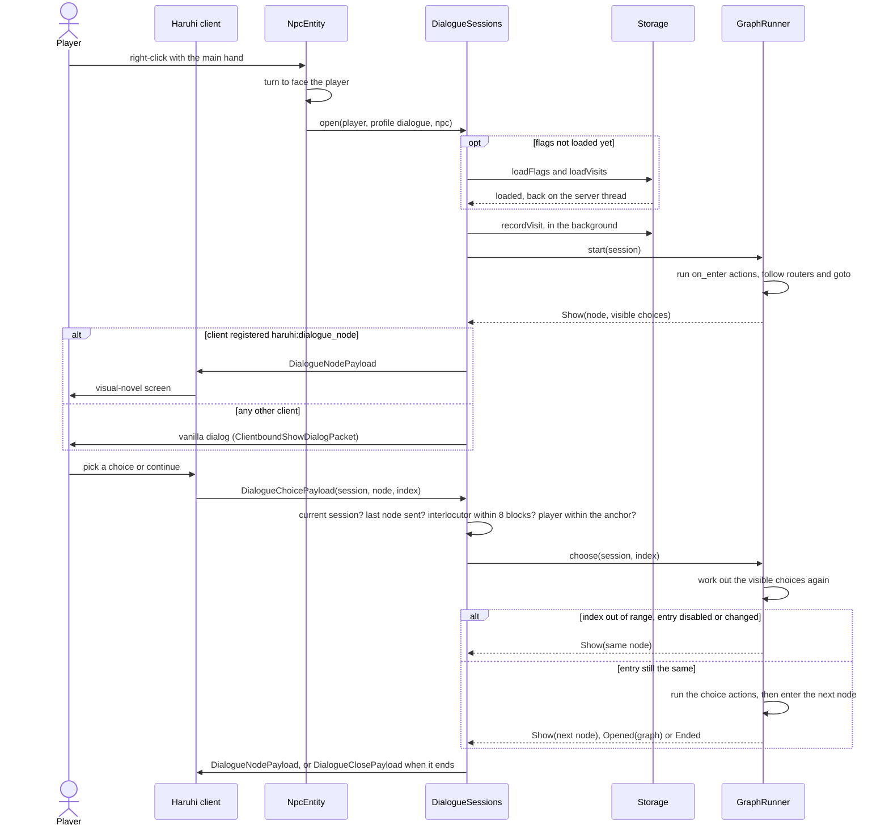

# Developer guide

For developers who build Haruhi, change it, or extend it from another mod. Back to the [README](../README.md).
Operating a server is in the [server guide](server-guide.md), the bundle format in the [content
guide](content-guide.md), and the model pipeline in [models and animations](models-and-animations.md).

- [Architecture](#architecture)
- [A conversation from click to close](#a-conversation-from-click-to-close)
- [Network payloads](#network-payloads)
- [Extending Haruhi from another mod](#extending-haruhi-from-another-mod)
- [Adding a storage backend](#adding-a-storage-backend)
- [Building and testing](#building-and-testing)
- [Repository layout](#repository-layout)

## Architecture

### Modules

| Module | Package | Delivers | Uses |
|---|---|---|---|
| storage | `town.lampas.haruhi.storage` | `StorageModule`: reads `config/haruhi.json`, builds `InMemoryStorage` or `PostgresStorage`, runs the SQL migrations | nothing |
| content | `town.lampas.haruhi.content`, `content.model`, `content.api`, `content.remote` | `ContentModule`: bundle parsing and validation, canonical JSON and SHA-256 digest, revisions, the startup load, `/haruhi content`, and the `haruhi:content/*` management methods with the Portal fetch (`config/haruhi-content.json`) | storage, `DialogueRegistries`; binding and npc at use time, for `haruhi:content/bindings` |
| dialogue | `town.lampas.haruhi.dialogue` and its subpackages, `town.lampas.haruhi.mixin` (except `JsonRpcParamsLogMixin`, which is content's) | `DialogueModule`: sessions, the graph runner, the built-ins, the flag and visit cache with write-behind, payload receivers, the vanilla dialog presenter, `/haruhi dialogue` and `/haruhi flags` | content, storage, npc, network |
| npc | `town.lampas.haruhi.npc` | `NpcModule`: the `haruhi:npc` entity type, look and profile syncing, interaction, `/haruhi npc`, `NpcControl` | content, dialogue, network |
| binding | `town.lampas.haruhi.binding` | `BindingModule`: block bindings (per-dimension saved data `BlockBindings`), entity bindings (the persistent attachment `haruhi:binding`, `EntityBindings`), the server-side use callbacks that open a bound graph in place of the vanilla interaction, the block-break listener, `/haruhi bind`, `/haruhi unbind` and `/haruhi bindings`, and the read-only `BindingService` | content, dialogue, npc |
| network | `town.lampas.haruhi.network` | the payload records and `HaruhiNetworking.registerPayloadTypes` | nothing |
| client | `town.lampas.haruhi.client` | `NpcClient`: the GeckoLib renderer, the vanilla fallback renderer, the animation receiver. `DialogueClient`: the visual-novel screen and `DialogueHud`. | network, npc entity class |

### Initialisation order

`Haruhi.onInitialize`, the main entrypoint, runs on both sides:

1. `HaruhiNetworking.registerPayloadTypes()`
2. `StorageModule.init()`
3. `ContentModule.init()`
4. `DialogueModule.init()`
5. `NpcModule.init()`
6. `BindingModule.init()`

`HaruhiClient.onInitializeClient`, the client entrypoint, runs `NpcClient.init()` and then `DialogueClient.init()`.

A module may read the services of the modules before it during `init()`. A module that needs a later one reads it when
it is used: dialogue reads `NpcControl` only while a conversation runs. Content and dialogue read the storage through a
supplier at each call, so they reach the storage built for the current server.

### Services

`town.lampas.haruhi.api.HaruhiServices` holds one service per module. Each module sets its own in `init()`. A getter
called before its module has initialised throws `IllegalStateException("Haruhi <name> service is not initialised")`.

| Getter | Type | Set by | Use |
|---|---|---|---|
| `storage()` | `HaruhiStorage` | `StorageModule` | asynchronous flags, visits and revisions |
| `content()` | `ContentService` | `ContentModule` | the active bundle, activation listeners, parse and validate |
| `dialogue()` | `DialogueService` | `DialogueModule` | open and close conversations |
| `npc()` | `NpcControl` | `NpcModule` | is an entity an NPC, its profile id, play an animation, list the loaded NPCs |
| `bindings()` | `BindingService` | `BindingModule` | list block bindings and bound entities with their problems, read only |

`ContentService`, `DialogueService`, `NpcControl` and `BindingService` are server-thread only.

### Server lifecycle

Listeners run in registration order, which follows the initialisation order.

| Event | What runs |
|---|---|
| `SERVER_STARTING` | storage: rebuild the storage if a previous server closed it, run the PostgreSQL migrations (blocking). content: attach to the server and build the management method handlers for it. npc: remember the server. |
| `SERVER_STARTED` | content: the startup load (active revision, else `config/haruhi/bundle.json`, else the seed) |
| `ServerPlayerEvents.JOIN` | dialogue: start loading the player's flags and visits |
| `END_SERVER_TICK` | dialogue: end sessions whose player died, whose interlocutor (an NPC or a bound entity) is gone or more than 8 blocks away, or whose player left the `openAt` anchor; retry failed loads, flush flag batches every 100 ticks; hand over waiting `haruhi:give` rewards |
| `AFTER_RESPAWN`, `AFTER_DEATH` | dialogue: end the conversation; the new player entity takes over the cached flags |
| `ServerPlayerEvents.LEAVE` | dialogue: drop the session and the cache, flush the player's pending flags |
| `SERVER_STOPPING` | dialogue: drop every session, flush every batch and wait up to 10 seconds; log rewards that are still waiting |
| `SERVER_STOPPED` | storage: close (queued work gets a 10-second grace). content: forget the management requests, stop the Portal fetcher, back to the empty bundle. npc: forget the server. |
| `ServerLevelEvents.LOAD` | binding: read the dimension's block bindings |
| `UseBlockCallback`, `UseEntityCallback` | binding: a bound block or entity opens its graph and the vanilla interaction is skipped (see the [server guide](server-guide.md#binding-behaviour)) |
| `UseItemCallback` | binding: refuse the held item's use in the tick a binding consumed a use and the next |
| `PlayerBlockBreakEvents.BEFORE`, `AFTER`, `END_SERVER_TICK` | binding: note a bound block a player is breaking (and the other half of a door, tall plant or bed), then remove its binding once the block is gone. The tick's end catches a creative player breaking a door's upper half, which fires no `AFTER` |
| `ServerLivingEntityEvents.AFTER_DEATH`, `MOB_CONVERSION`, `ServerEntityEvents.ENTITY_UNLOAD` | binding: `EntityBindingEnds` takes a bound entity's binding off and logs the end once, on a death, a conversion, or an unload whose removal reason destroys the entity |
| `ServerPlayerEvents.LEAVE`, `SERVER_STOPPED` | binding: `BindingInteractions` forgets the leaving player's consumed uses, and clears them all at the stop |
| content activation listener | npc: refresh the look of every loaded NPC from the new bundle |

A singleplayer client can start several servers in one JVM. Storage, content and the queues reset on each stop, so the
next start begins clean.

### Threading rules

- Storage calls return `CompletableFuture`s that complete on storage threads, never on the calling thread. Nothing
  blocks the server thread except these: at `SERVER_STARTING`, the migrations and, after an earlier server stopped,
  building the storage again (for PostgreSQL this opens the pool and its first connection); the bounded flush at
  `SERVER_STOPPING`; and the storage's bounded close at `SERVER_STOPPED`.
- Results hop back to the server thread through `server.execute(...)` before they touch game state
  (`content.ServerThread.hop`, `dialogue.ServerThread.execute`). Once the server has stopped, `execute` would run the
  task inline on the storage thread, so both helpers drop such a task and log a warning.
- `StorageExecutor` completes every future it hands out, with the result, the failure, or
  `IllegalStateException("Haruhi storage closed before this operation ran")`, so no caller waits on work that will never
  run.
- One player's storage operations run in order through `OrderedWrites`, so a load never overtakes a write submitted
  before it.
- Activations, rollbacks and the startup load run one at a time through `ActivationQueue`, and so do activations through
  `haruhi:content/activate`.
- Management methods run on the server thread, where vanilla's management server waits for them, except
  `haruhi:content/list` and `export`: they run on the management connection's thread and wait for storage up to 3
  seconds there. The Portal fetch runs on the HTTP client's threads and hops back to the server thread to validate and
  store.

### Client and server split

- Code that refers to `net.minecraft.client` or `com.geckolib` lives under `town.lampas.haruhi.client`.
  `ArchitectureTest` reads every compiled main class outside that package and fails the build if its constant pool
  names either prefix. The Lampas server does not ship GeckoLib, and a dedicated server has no client classes.
- GeckoLib is `compileOnly` (to compile the client package), `localRuntime` (for `runClient`, `runServer` and
  `runGameTest`) and `testRuntimeOnly` (for the unit tests) in `build.gradle`. None of these reaches the published
  POM or Gradle module metadata, so the jar does not depend on it, and `fabric.mod.json` only recommends it. Do not
  use `runtimeOnly`, which would publish it: `check` fails if GeckoLib appears in either file.
- Inside the client package, only `client.npc.gecko` refers to GeckoLib classes. `NpcClient` calls into it after
  `FabricLoader.isModLoaded("geckolib")`, so those classes never load without GeckoLib. `ArchitectureTest` does not
  check this inner boundary; keep it by hand.
- `NpcEntity` is a plain `LivingEntity`. Its look travels as three vanilla `STRING` synced-data entries (model,
  texture, animations), its name as the vanilla custom name, and its scale as the vanilla `scale` attribute, so it needs
  no custom entity-data serializer.
- The common mixin config `haruhi.mixins.json` holds `DialogueClickMixin` (dialogue) and `JsonRpcParamsLogMixin`
  (content, which replaces the params of a `haruhi:` call in vanilla's DEBUG log line). The client mixin config is
  empty.

### The HUD under the dialogue screen

`DialogueScreen` draws no background, so `DialogueHud` replaces vanilla HUD elements through Fabric API's
`HudElementRegistry`. While the screen is open it skips `HOTBAR`, `ARMOR_BAR`, `HEALTH_BAR`, `FOOD_BAR`, `AIR_BAR`,
`MOUNT_HEALTH`, `INFO_BAR`, `EXPERIENCE_LEVEL`, `HELD_ITEM_TOOLTIP` and `CROSSHAIR`, and translates `CHAT` up so its
bottom edge sits 4 pixels above the text box, or above the choice list when the list reaches across the chat. Every
other element draws as usual.

Known gap: Fabric API's `INFO_BAR` wraps only `ContextualBar.extractBackground`. The locator bar draws its waypoint
markers in `LocatorBar.extractRenderState`, which has no HUD element, so the markers still draw under the box. The
experience and jump bars draw nothing in that step, so they are fully hidden.

### Pages in the dialogue screen

The client pages a node's text; the server and the payloads know nothing of pages. `DialogueLayout` caps the box at
40% of the screen's height (but never below a full headshot with its padding) and below the room kept for up to
three choice rows, and gives `pageLines`, the lines the box holds. `DialogueScreen` wraps the text with `font.split` and
hands the lines' code points to `TextPages`, which splits them into pages of whole lines, ending a page early at a
blank line in its lower half and starting no later page on a blank line. Each page types out with its own
`Typewriter`. A press on a finished page turns to the next one locally; only a press on the last page sends
`DialogueChoicePayload.CONTINUE`, and choices are drawn and pickable only on the last page. Minecraft passes key
repeats to `keyPressed` without marking them, so the screen keeps the advance keys that are down (`keyReleased`
takes them off) and lets a repeat only finish the typing.

Wrapping drops the space or line break at each break, so a character offset is only valid for one wrap. When the
screen lays out again (`init()` on a resize or GUI scale change, or the speaker loading or unloading, which adds or
removes the 3D headshot), it carries the start of the current page and how far the text has been shown as counts of
non-whitespace characters, which do not depend on the wrap, and maps them back with `TextPages.charOfGlyph`. Every
node payload starts on the first page, the node on screen sent again included: the payload does not tell a choice that
leads back to its own node from a refused pick, and the first must repeat the whole speech.

## A conversation from click to close



What the server checks, and in what order:

1. A pick counts only when its session id is the player's current session and its node id is the node last sent.
   Anything else is ignored without a reply. The client stops taking input after a pick until the next node arrives,
   for at most 2 seconds.
2. A conversation with an interlocutor (an NPC or a bound entity) ends when the interlocutor is dead, in another
   level, or more than 8 blocks away, and one opened with `openAt` ends when the player is outside the anchor. The tick
   handler checks the same every tick.
3. The runner works out the node's visible entries again, running the conditions and providers. The index must be in
   range of both the list it sent and the new list, the entry must be enabled, and it must be the same choice, the
   same provided position and the same text. Otherwise the node is shown again and nothing runs. An index of -1
   continues a node that has no visible entries.
4. The choice's actions run in order. An action that throws ends the conversation and is logged. A `goTo`, `end` or
   `openGraph` call replaces the choice's `next`; the last call in a batch wins.
5. Entering the next node runs its `on_enter` actions, then follows routers and jumps until a node with text is
   reached. A router tests its branches' `only_if` conditions after its `on_enter`, picks by weight among those that
   hold, and moves to its `next` when none hold, or ends without one; a condition that throws ends the conversation
   and is logged. One step may enter at most 64 nodes and chain at most 8 graphs through `haruhi:open`.

The client sends only the session id, the node id and the choice index. Actions never travel to the client.

A player has at most one session. Opening a conversation closes the previous one. A session keeps the bundle and the
compiled graph it opened with, so a content activation does not change a conversation in progress, except that a
`haruhi:open` reached after the activation opens the graph from the active content, or ends the conversation when the
active content lacks it. Graphs are compiled
on first use, and compiled again on their first use after each activation.

The node's `animation` is played by the conversing player's own client on the speaker entity, from the payload. The
`haruhi:animation` action instead sends `NpcAnimationPayload` to every player tracking the NPC. Both apply only to a
`haruhi:npc`; on any other interlocutor, such as a bound villager, they do nothing.

A bound block or entity goes through the same service: `BindingInteractions` calls `openAt` with an anchor on the
block's centre (8 blocks, or the player's block reach plus 3 when that is longer, up to 64) or `open` with the entity as the interlocutor, each with a `DialogueSpeaker` made of the
binding's speaker profile and the block's or entity's name. The Fabric use callbacks run before vanilla, so returning a
non-`PASS` result skips the container, trade screen or item use. The client does not know the bindings: when its own
guess of the block or entity use passes, it goes on to send a use of the held item, which `UseItemCallback` refuses in
that tick and the next.

## Network payloads

Every payload type is registered on both sides by `HaruhiNetworking.registerPayloadTypes()`, in the play phase.

| Id | Direction | Fields | Sent when |
|---|---|---|---|
| `haruhi:dialogue_node` | server to client | `sessionId` varint, `graphId` id, `nodeId` string, `speakerEntityId` optional varint, `speakerName` component, `text` component, `animation` optional string, `portrait` optional id, `choices` list of `ChoiceView` | a node is shown to a client that registered this channel |
| `haruhi:dialogue_close` | server to client | `sessionId` varint | the conversation ends; the client closes the screen if it still shows that session |
| `haruhi:npc_animation` | server to client | `entityId` varint, `animation` string | `NpcControl.playAnimation`, to every tracking player that registered the channel; ignored without GeckoLib |
| `haruhi:dialogue_choice` | client to server | `sessionId` varint, `nodeId` string, `choiceIndex` varint (`-1` = continue) | the player picks a choice or continues |
| `haruhi:dialogue_dismiss` | client to server | `sessionId` varint | the player presses Escape; the session ends and no action runs |

`ChoiceView` is `index` varint, `text` component, `enabled` boolean, `unavailableReason` optional component. Hidden
choices are left out of the list. Grayed-out choices stay in it with `enabled` false, so the indices after them do not
move when they become available. `speakerEntityId` is set only when the entity the player talks to (an NPC, or a
bound entity) is the node's speaker. `portrait` is the node's portrait, else the speaker profile's.

A client without the `haruhi:dialogue_node` channel gets vanilla dialogs instead (`dialogue.presenter.VanillaDialogs`):
a `MultiActionDialog` for a node with choices, a `NoticeDialog` with a Continue button for one without. Each button
carries a custom click event:

| Click id | Payload (NBT compound) |
|---|---|
| `haruhi:dialogue_choice` | `session` int, `node` string, `choice` int |
| `haruhi:dialogue_dismiss` | `session` int |

Vanilla only logs custom clicks, and Fabric API has no event for them, so `DialogueClickMixin` injects at the head of
`ServerCommonPacketListenerImpl.handleCustomClickAction` and hands them to the same `choose` and `dismiss` the
payloads use. The end of a conversation sends `ClientboundClearDialogPacket` to such a client.

## Extending Haruhi from another mod

Another mod adds its own condition, action and choice-provider types, and bundles then use them by id. Haruhi itself
registers conditions and actions under the `haruhi` namespace and no providers.

### Depending on Haruhi

Haruhi releases are published to the JustBecause Maven repository
([justbecauseph/maven](https://github.com/justbecauseph/maven)) as `town.lampas:haruhi`, by the release workflow
(`.github/workflows/release.yml`) when a GitHub release `v<mod_version>` is published. Minecraft 26.2 is not
obfuscated, so a plain `implementation` dependency on the jar works with Loom:

```groovy
repositories {
    maven {
        url = 'https://justbecauseph.github.io/maven'
        content { includeGroup 'town.lampas' }
    }
}

dependencies {
    implementation "town.lampas:haruhi:0.3.1"
}
```

Declare `"depends": { "haruhi": ">=0.3.0" }` in your `fabric.mod.json`. `>=0.2.0` is enough for a mod that calls
none of the 0.3.0 additions, `HaruhiServices.bindings()` and the npc service's list of loaded NPCs. To build against a checkout of the Haruhi
repository instead, for a change that is not published yet, add `includeBuild('../haruhi')` to your
`settings.gradle`: Gradle substitutes the dependency with that build. [Alina](https://github.com/justbecauseph/alina)
does both, and builds against the published jar when no checkout sits beside it.

The jar also holds the bundle schema as `haruhi/bundle.schema.json`, so a mod that publishes a schema for its own
bundle extension can check it against the Haruhi version it depends on.

The dialogue API is in `town.lampas.haruhi.dialogue.api`, and the bundle extension API (`ContentExtensions`,
`ContentExtensionKey`, `ContentExtensionType`, `ExtensionContext`) in `town.lampas.haruhi.content.api`. They also use
`ContentBundle` and `FlagNamespace` from `town.lampas.haruhi.content.model` and `FlagKey` from
`town.lampas.haruhi.storage`.

### Registering types

`DialogueRegistries` has three registries, keyed by `Identifier`:

| Method | Parser type | Parsed value | Runs |
|---|---|---|---|
| `registerCondition(id, ConditionType)` | `DataResult<DialogueCondition> parse(JsonObject args, ParseContext context)` | `boolean test(DialogueContext)` | each time the node's choices are worked out, and each time a router tests its branches' `only_if`; must have no side effects |
| `registerAction(id, ActionType)` | `DataResult<DialogueAction> parse(JsonObject args, ParseContext context)` | `void run(DialogueContext)` | when a node is entered (`on_enter`) or a choice is picked (`actions`) |
| `registerProvider(id, ChoiceProviderType)` | `DataResult<ChoiceProvider> parse(JsonObject args, ParseContext context)` | `List<ProvidedChoice> provide(DialogueContext)` | each time the node is shown, and again when a pick arrives |

- Register from your `onInitialize`. Bundles are first validated when the server has started, after every mod's main
  entrypoint has run. Use your own namespace. Registering an id twice throws
  `IllegalStateException("Dialogue <kind> <id> is already registered")`.
- `args` is the spec object with its `type` key removed. Reject argument names you do not take: the built-ins do, so
  a misspelt argument fails validation instead of being ignored.
- Return `DataResult.error(...)` for a bad argument. Validation prefixes the message with where the spec sits,
  `<graph>#<node>`, `<graph>#<node>, choice <n>` or `<graph>#<node>, random entry <n>`, unless it already starts with
  `context.where()`. A parser that
  throws during validation is recorded as `parsing failed with <exception>`. When a graph is compiled for a
  conversation, only an `IllegalStateException` is caught, so return errors rather than throwing.
- A parser runs at every validation (`/haruhi content validate`, `import`, `activate`, and the startup load) and again
  when the graph is compiled on its first use after an activation. Keep it deterministic and free of side effects, and
  read only its arguments and `ParseContext`, never the active content.
- A condition or provider that throws while a conversation runs ends the conversation, as an action that throws does.

### Example

```java
package com.example.jobs;

import com.google.gson.JsonElement;
import com.mojang.serialization.DataResult;
import java.util.List;
import java.util.Optional;
import net.fabricmc.api.ModInitializer;
import net.minecraft.network.chat.Component;
import net.minecraft.resources.Identifier;
import town.lampas.haruhi.dialogue.api.ChoiceProvider;
import town.lampas.haruhi.dialogue.api.DialogueAction;
import town.lampas.haruhi.dialogue.api.DialogueCondition;
import town.lampas.haruhi.dialogue.api.DialogueRegistries;
import town.lampas.haruhi.dialogue.api.ProvidedChoice;

public final class JobsDialogue implements ModInitializer {
    @Override
    public void onInitialize() {
        // { "type": "example:min_level", "level": 10 }
        DialogueRegistries.registerCondition(Identifier.fromNamespaceAndPath("example", "min_level"),
                (args, context) -> {
                    JsonElement level = args.get("level");
                    if (args.size() != 1 || level == null || !level.isJsonPrimitive()
                            || !level.getAsJsonPrimitive().isNumber()) {
                        return DataResult.error(() -> "example:min_level takes one number argument, 'level'");
                    }
                    int min = level.getAsInt();
                    return DataResult.<DialogueCondition>success(ctx -> ctx.player().experienceLevel >= min);
                });

        // { "type": "example:grant_xp", "points": 50 }
        DialogueRegistries.registerAction(Identifier.fromNamespaceAndPath("example", "grant_xp"),
                (args, context) -> {
                    JsonElement points = args.get("points");
                    if (args.size() != 1 || points == null || !points.isJsonPrimitive()
                            || !points.getAsJsonPrimitive().isNumber()) {
                        return DataResult.error(() -> "example:grant_xp takes one number argument, 'points'");
                    }
                    int amount = points.getAsInt();
                    return DataResult.<DialogueAction>success(ctx -> ctx.player().giveExperiencePoints(amount));
                });

        // "provider": { "type": "example:jobs" }
        DialogueRegistries.registerProvider(Identifier.fromNamespaceAndPath("example", "jobs"),
                (args, context) -> {
                    if (!args.isEmpty()) {
                        return DataResult.error(() -> "example:jobs takes no arguments");
                    }
                    return DataResult.<ChoiceProvider>success(ctx -> List.of(
                            new ProvidedChoice(Component.literal("Deliver the letters"), true, Optional.empty(),
                                    pick -> pick.player().sendSystemMessage(Component.literal("Job taken.")),
                                    Optional.of("job_taken")),
                            new ProvidedChoice(Component.literal("Clear the mine"),
                                    ctx.player().experienceLevel >= 10,
                                    Optional.of(Component.literal("Needs level 10.")),
                                    DialogueAction.NONE, Optional.of("job_taken"))));
                });
    }
}
```

A graph that uses them:

```json
{
  "start": "board",
  "nodes": {
    "board": {
      "text": "What work is there?",
      "choices": [
        { "provider": { "type": "example:jobs" } },
        { "text": "A bonus, please.", "next": "bye",
          "only_if": [ { "type": "example:min_level", "level": 30 } ],
          "actions": [ { "type": "example:grant_xp", "points": 50 } ] },
        { "text": "Nothing today.", "next": "bye" }
      ]
    },
    "job_taken": { "text": "Good luck out there." },
    "bye": { "text": "Safe travels." }
  }
}
```

No edge in the graph reaches `job_taken`. Validation allows that because a node reachable from `start` holds a
provider choice, and a provider names its next node only at run time.

### ParseContext

`ParseContext(ContentBundle bundle, Identifier graphId, String nodeId)` describes where a spec is being parsed.

| Member | Gives |
|---|---|
| `bundle()` | the bundle being validated, not the active one |
| `graphId()`, `nodeId()` | the graph and node that hold the spec |
| `isFlagDeclared(FlagKey)` | whether the bundle's `flags` section declares that namespace and lists that flag |
| `extension(ContentExtensionKey<T>)` | the bundle's parsed section of a registered extension, if it holds one |
| `where()` | `<graph>#<node>: `, the prefix for error messages |

A type that reads or writes flags should check `isFlagDeclared` at parse time, as the built-ins do. Nothing checks
flag declarations while a conversation runs.

### DialogueContext

What a condition, action or provider sees while a conversation runs. It is valid only during the call it is passed to,
and only on the server thread.

| Member | Gives or does |
|---|---|
| `player()` | the `ServerPlayer` in the conversation |
| `interlocutor()` | the entity the player talks to: an NPC, or any entity a binding opened the graph on; empty for a conversation opened at a block or by a command |
| `anchor()` | the `DialogueAnchor` of a conversation opened with `openAt`; empty otherwise |
| `graphId()`, `nodeId()` | the graph, and the node being entered or whose choice was picked |
| `content()` | the bundle the conversation runs on |
| `flags()` | the player's `DialogueFlags`: `get`, `isSet`, `set`, `add`, `clear` on a `FlagKey(namespace, flag)` |
| `visits()` | how many times this character has opened this graph with this NPC profile (the interlocutor NPC's, else the `DialogueSpeaker` profile, else `haruhi:none`), counting the current conversation |
| `goTo(nodeId)` | after the current actions, enter this node instead of the choice's `next` |
| `end()` | after the current actions, close the conversation |
| `openGraph(graphId)` | after the current actions, close this conversation and open another graph with the same interlocutor, anchor and `DialogueSpeaker` |

Flag values are integers. `isSet` is true for any value other than 0, and an unset flag reads 0. `add` uses
`Math.addExact`, so an overflow throws and ends the conversation. Writes change the cache at once and reach storage in
the next batch (see the [server guide](server-guide.md#flags-and-visits)). For an effect that must not repeat after a
crash, check `context.flags() instanceof DurableFlags` (in `town.lampas.haruhi.dialogue.flags`) and call
`setDurable(key, value)`, which completes when storage has the value and fails, restoring the old value, if the write
fails. `haruhi:give` works this way.

`goTo` targets are not checked by validation for your own action types, and neither is the `next` of a provided choice.
A target that does not exist ends the conversation at run time with `Dialogue <graph> has no node <node>; ending the
conversation`.

### Choice providers

A provider choice is a choice with `provider` instead of `text`. Its `only_if` conditions gate the whole expansion:
when they fail, none of its entries are shown, grayed out or not. Its `actions` are parsed but never run.

`ProvidedChoice(Component text, boolean enabled, Optional<Component> unavailableReason, DialogueAction onChoose,
Optional<String> next)`:

- `enabled` false shows the entry grayed out with `unavailableReason`. Its `onChoose` never runs.
- `onChoose` runs when the player picks the entry, after the server has run the provider again and found an enabled
  entry with the same text at the same position. Return entries in a stable order, and keep their text stable between
  showing the node and the pick, or the pick only shows the node again.
- `next` is the node entered afterwards. Empty ends the conversation, unless `onChoose` moved or ended it.
- `text` and `unavailableReason` are sent as given. Bundle text is resolved for the player at gamemaster permission
  (see the content guide), but entry text is not, because a provider may build it from player-made text such as an
  item's custom name, and resolving that at gamemaster permission would let a player read other players' data. If an
  entry needs a score or selector, resolve it in the provider at a permission you choose.

### Bundle extensions

A mod can keep its own content in the bundle, under the top-level `extensions` object, so it is validated, stored,
activated and rolled back with the dialogue that uses it. Register the section's parser in `onInitialize`:

```java
public static final ContentExtensionKey<GuildContent> GUILD = ContentExtensions.register(
        Identifier.fromNamespaceAndPath("example", "guild"), GuildContent.class, (section, context) -> {
            // Report every problem with context.problem(...); return empty when the section is unusable.
            return GuildContent.parse(section, context);
        });
```

| `ExtensionContext` member | Gives |
|---|---|
| `id()` | the extension id |
| `bundle()` | the bundle being validated, without extensions: flag namespaces, and the NPCs and graphs that parsed |
| `npcIds()`, `graphIds()` | every NPC and graph id the bundle declares, including entries that failed to parse; check references against these |
| `ops()` | the ops bundle text parses with; on a server they are `RegistryOps` over the server's registries |
| `problem(where, message)`, `problem(message)` | records a problem; the second form is located at `extension <id>` |

Sections are parsed after flags, NPCs and graphs, and before any condition, action or provider, so your dialogue types
can check ids against your section through `ParseContext.extension(GUILD)`. A parser that throws is recorded as a
problem. The parser gets a copy of its section, so changing it does not change the stored revision. A bundle that
holds a section under an id nobody registered is refused. Read the active section with
`HaruhiServices.content().active().extension(GUILD)`, and rebuild any index of it in an activation listener. The value
should be immutable, because every reader of the active bundle shares it.

### Other services

| Call | Does |
|---|---|
| `HaruhiServices.dialogue().open(player, graphId, interlocutor)` | opens a graph of the active content; `interlocutor` may be null. When it opens, it closes the player's current conversation. Returns false, leaving the current conversation running, when the active content lacks the graph. |
| `HaruhiServices.dialogue().openAt(player, graphId, anchor)` | opens a graph tied to a place: a `DialogueAnchor(dimension, position, maxDistance)`, with `maxDistance` above 0 and at most 64 blocks. The conversation ends when the player changes dimension or moves farther than `maxDistance` from `position`, and a pick sent from farther away ends it without running. A graph chained with `haruhi:open` keeps the anchor. Also returns false, without closing anything, when the player is outside the anchor at open time. Use it for a block such as a notice board. |
| `open(player, graphId, interlocutor, speaker)`, `openAt(player, graphId, anchor, speaker)` | the same, with a `DialogueSpeaker(profile, name)` for the nodes that name no `speaker`: they show the profile's name and portrait, else `name`, and the interlocutor is drawn as their headshot. A block binding passes `DialogueSpeaker.of(<the binding's speaker profile>, block.getName())`. The three-argument forms pass `DialogueSpeaker.NONE`, where a `haruhi:npc` interlocutor speaks with its own profile. A chained `haruhi:open` keeps the speaker. |
| `HaruhiServices.dialogue().close(player)` | ends the conversation, or cancels one waiting for the player's flags |
| `HaruhiServices.dialogue().isInDialogue(player)` | true while a conversation is open or waiting for flags |
| `HaruhiServices.content().active()` | the active `ContentBundle`; `ContentBundle.EMPTY` before any is active |
| `HaruhiServices.content().addActivationListener(listener)` | called on the server thread every time a bundle becomes active, including at startup |
| `HaruhiServices.content().parseAndValidate(json)` | full validation; the error message lists every problem, one per line |
| `HaruhiServices.npc().isNpc(entity)`, `profileId(entity)`, `playAnimation(entity, name)` | NPC queries and animations |

Call these getters from server events or later, not from your `onInitialize`: Haruhi's services may not be set yet
when your entrypoint runs, and a getter called too early throws. `DialogueRegistries` is static and safe to call from
`onInitialize`.

## Adding a storage backend

`HaruhiStorage` is the interface for durable state. `StorageModule.build` chooses between the two built-in backends from
`storage.type`, and there is no hook to plug in a backend from another mod. A new backend is a change to this
repository:

1. Implement `town.lampas.haruhi.storage.HaruhiStorage`.
2. Add its `type` to `StorageConfig.Backend` and to the `type` switch in `StorageConfig.parse`, with any keys it needs
   in `KEYS` and the default file.
3. Build it in `StorageModule.build`, and run any blocking setup the way `PostgresStorage.migrate()` runs, from
   `StorageModule.start` at `SERVER_STARTING`.
4. Subclass `HaruhiStorageContractTest` (in `src/test/java/town/lampas/haruhi/storage/`) with a `createStorage()` that
   returns a fresh, empty instance. `InMemoryStorageTest` and `PostgresStorageTest` do the same. Add the backend's
   `backendName()` to the names `theBackendNamesItself` accepts, which are only `memory` and `postgresql`.

The contract, from `HaruhiStorage` and `StorageSupport`:

| Method | Must |
|---|---|
| every method | return a future that completes off the calling thread, and never block the server thread |
| `loadFlags(characterId)` | return every flag of the character; a flag that was never set or was cleared is absent, not 0 |
| `writeFlags(characterId, changes)` | apply the changes in order and atomically; a change with an empty value deletes the flag. Refuse a namespace or flag containing a NUL character. |
| `loadVisits(characterId)` | return every visit counter of the character |
| `recordVisit(characterId, key, at)` | increment one counter, creating it at 1, and return the new record |
| `storeRevision(digest, json, author, at)` | store a new inactive revision; for a digest already stored, return the existing revision instead |
| `loadRevision(id)`, `activeRevision()` | return the revision, or empty |
| `activateRevision(id, actor, at)` | mark that revision active and every other one inactive, recording the actor and time; fail for an unknown id and leave the previous active revision as it was |
| `listRevisions(before, limit)` | return at most `limit` summaries, newest (highest id) first; with `before`, only ids below it; fail for a limit below 1. `listRevisions(limit)` is a default method that passes no `before`. |
| `backendName()` | return the backend's name for status reports (`haruhi:content/status` `storage`) |
| `close()` | stop the backend; complete or fail every future already handed out |

Times are kept to the microsecond, the precision of PostgreSQL's `timestamptz`. `characterId` is the player's UUID.

## Building and testing

Java 25 (the compiler runs with `--release 25`) and the Gradle 9.5.1 wrapper. On Windows, use `.\gradlew.bat` in place
of `./gradlew`.

### Gradle tasks

| Task | Does |
|---|---|
| `./gradlew build` | compiles, builds the jars, runs `test` and, through `check`, `runGameTest` |
| `./gradlew assemble` | builds `build/libs/haruhi-0.3.1.jar` and the sources jar without running tests |
| `./gradlew test` | the JUnit 5 unit tests, including `ArchitectureTest` and the converter tests |
| `./gradlew runGameTest` | the server GameTests |
| `./gradlew runClient` | a development client with Haruhi and GeckoLib, for checking the screen and the renderer by hand |
| `./gradlew runServer` | a development dedicated server |
| `./gradlew bbmodel --args='<in.bbmodel> <outputRoot> <namespace> <name>'` | the Blockbench converter |

`runClient` and `runServer` use the `run/` folder, which git ignores.

### Unit tests

Unit tests live in `src/test/java/town/lampas/haruhi/`, one package per component, and run on JUnit 5 without a
Minecraft server. `test` depends on `classes` and passes the compiled main classes to `ArchitectureTest` through the
`haruhi.mainClasses` system property. The test classpath also includes the `tools` source set's output.

- `storage/`: the config parser, `StorageExecutor`, the migration file loader, and `HaruhiStorageContractTest` run
  against `InMemoryStorage` and `PostgresStorage`.
- `content/`: the validator, digest, bundle files, the startup choice, commands, the content service and the
  activation order. `BundleSchemaTest` checks `docs/bundle.schema.json` against the bundle reader: the same keys at
  every level, the same verdict on a set of malformed bundles, and acceptance of the seed, the GameTest fixtures and
  every full bundle in `AGENTS.md`, `README.md` and `docs/`. `BundleExtensionsTest` covers bundle extensions.
- `content/remote/`: the management methods' param checks and log redaction, the request table, the Portal fetcher,
  `config/haruhi-content.json`, export text chunks and the bindings pages.
- `dialogue/`: the dialogue config, built-in parsing and evaluation, commands, the flag cache and write-behind, the
  presenters and the graph runner. `BuiltinSchemaTest` checks that the schema lists exactly the registered `haruhi:`
  conditions and actions and gives the same verdict as their parsers on a set of argument cases.
- `npc/`: commands, facing and look syncing.
- `binding/`: the saved form of block bindings and its tolerant load, which block states a binding applies to, the
  other half of doors, tall plants, beds and double chests, the problems `/haruhi bindings` marks, and the command
  tree's permission gate. The speaker rules of a bound conversation are in `dialogue/presenter/SpeakerTest`.
- `client/`: the screen's layout, keys, HUD decisions and typewriter, the client config, headshot framing, and the
  GeckoLib renderer.
- `tools/bbmodel/`: the converter, including `GeckoLibBakeTest`, which has GeckoLib 5.5.5 bake converted output.

Tests that need a working GeckoLib run their code in a separate class loader (`GeckoLibSandbox`,
`GeckoLibBakeSandbox`), because GeckoLib's setup registers a data component, which a JVM cannot do once another test has
frozen the registries.

The two schema tests use networknt `json-schema-validator`, a test-only dependency. They read the schema, the docs and
the GameTest fixtures from the project directory, and `build.gradle` declares those files as inputs of `test`, so
editing any of them reruns the tests.

### PostgreSQL tests and Docker

`PostgresStorageTest` runs the storage contract, the migrations, the privilege cases, the unique index, concurrent
activations from two storages, the socket timeout and server limits every pooled connection carries, and lock waits that
fail on the server's `lock_timeout` without committing, against a `postgres:18.4` container through Testcontainers. It is
annotated `@Testcontainers(disabledWithoutDocker = true)`, so without a running Docker daemon its tests are reported as
skipped and `build` still passes. Check the test report to see whether they ran.

### Server GameTests

The `gametest` source set and the `runGameTest` task come from `fabricApi { configureTests { ... } }` in
`build.gradle`, with mod id `haruhi-gametest`. Client GameTests are disabled.

- Entrypoints, listed in `src/gametest/resources/fabric.mod.json`: `StorageGameTests`, `ContentGameTests`,
  `NpcGameTests`, `DialogueGameTests`, `BindingGameTests`, in `town.lampas.haruhi.gametest`.
- `BindingGameTests` binds a chest and a librarian with the real commands, uses them as the server handles a client's
  use (`handleInteract` for the entity, `ServerPlayerGameMode.useItemOn` for the block, because the packet handler
  drops block uses until a client confirms its join teleport, which a mock player never does), and checks that the
  conversation opens and the chest's inventory or the trades do not, that unbinding brings them back, that a missing
  graph opens nothing and is listed, that a held item's use right after a consumed click is refused, that a broken
  block loses its binding and a replaced one waits for its block, that a door, a bed and a double chest answer on both
  halves with one binding, and that an entity binding is saved with the entity.
- Fixtures: `src/gametest/resources/haruhi/fixtures/<component>/`. Test environments:
  `src/gametest/resources/data/haruhi-gametest/test_environment/`.
- A test that activates its own content first waits until `HaruhiServices.content().isStartupComplete()`, so the
  startup load cannot replace its fixture afterwards.
- The server runs in `build/run/gameTest`. The JUnit XML report goes to
  `build/test-results/gameTest/TEST-haruhi-gametest.xml`.

### Manual checks with runClient

The visual-novel screen, the HUD changes and the GeckoLib renderer have unit tests for their arithmetic, but no client
GameTests. Check them by hand in `runClient`: open a world, spawn an NPC with `/haruhi npc spawn`, and talk to it.
For pages, give a node a text of several paragraphs, then check the indicator, that Space turns pages with no wait,
that the choices appear only on the last page, and that a resize or GUI scale change mid-speech keeps the place.

### The bbmodel tool source set

`src/tools/java` is a separate `tools` source set whose only dependency is Gson 2.14.0. It is not in the mod jar, and
it has no Minecraft classpath. The `bbmodel` task runs `town.lampas.haruhi.tools.bbmodel.BbmodelCli`; relative paths
resolve against the project directory. What it writes and how it converts is in
[models and animations](models-and-animations.md).

## Repository layout

```
build.gradle, gradle.properties, settings.gradle   Loom build and pinned versions
README.md, LICENSE                                 overview and the MPL-2.0 text
AGENTS.md                                          brief for coding agents
docs/                                              these guides and bundle.schema.json (shipped in the jar, read by the schema tests)
.github/workflows/release.yml                      publishes to the JustBecause Maven repository on a GitHub release
src/main/java/town/lampas/haruhi/
  Haruhi.java                  main entrypoint, initialisation order
  api/HaruhiServices.java      service getters and setters
  storage/                     HaruhiStorage, InMemoryStorage, PostgresStorage, StorageConfig, migrations runner
  content/                     bundle reading and validation, digest, revisions, startup load, /haruhi content
  content/model/               the immutable bundle records: ContentBundle, NpcProfile, DialogueGraph, ...
  content/api/                 bundle extensions: ContentExtensions, ContentExtensionType, ExtensionContext
  content/remote/              the haruhi:content/* management methods: ContentRpc, ContentMethods, ContentRequests, BundleFetcher
  dialogue/                    DialogueModule, DialogueSessions, DialogueConfig
  dialogue/api/                the extension API: DialogueRegistries, ParseContext, DialogueContext, types
  dialogue/builtin/            the built-in conditions and actions
  dialogue/command/            /haruhi dialogue and /haruhi flags
  dialogue/flags/              per-player cache, write-behind, ordered writes, DurableFlags
  dialogue/presenter/          visual-novel payloads and vanilla dialogs
  dialogue/runtime/            compiled graphs, GraphRunner, sessions
  mixin/                       DialogueClickMixin, JsonRpcParamsLogMixin
  network/                     payload records and HaruhiNetworking
  npc/                         NpcEntity, NpcLook, NpcControl, /haruhi npc
  binding/                     block and entity bindings, their use callbacks, /haruhi bind, unbind and bindings
  client/                      HaruhiClient, the client entrypoint
  client/dialogue/             DialogueScreen, DialogueHud, layout, keys, typewriter, client config
  client/npc/                  vanilla renderer, headshot, asset fallback
  client/npc/gecko/            GeckoLib renderer and model support, loaded only with GeckoLib
src/main/resources/
  fabric.mod.json, haruhi.mixins.json, haruhi.client.mixins.json
  haruhi/seed_bundle.json      the seed content
  haruhi/migrations/           V1__init.sql
  assets/haruhi/geckolib/      the default humanoid model and its animations
  assets/haruhi/lang/en_us.json
src/test/java/town/lampas/haruhi/     unit tests, one package per component, plus tools/bbmodel
src/test/resources/                   GeckoLib fixture resource packs
src/gametest/java/town/lampas/haruhi/gametest/   server GameTests
src/gametest/resources/               haruhi-gametest metadata, test environments, fixtures
src/tools/java/town/lampas/haruhi/tools/bbmodel/ the Blockbench converter
```
